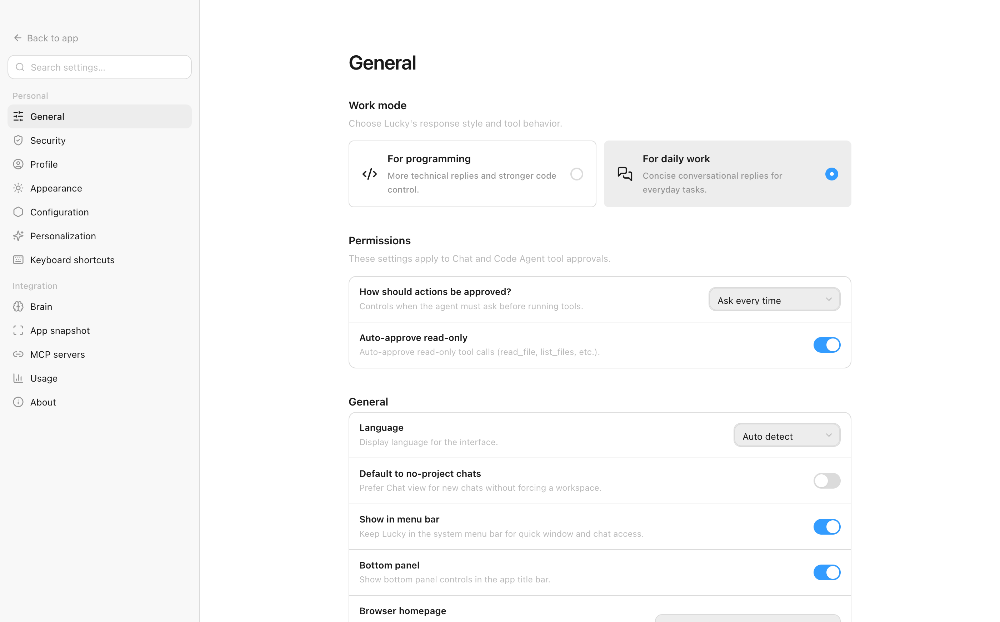
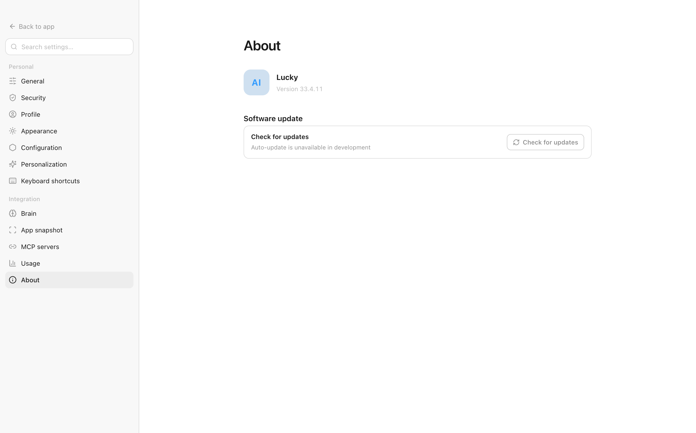

# Lucky

Lucky is an Electron + Vite + Vue + TypeScript desktop client for local AI agent workflows. The npm package name remains `lucky-ai-client`. It is a developer console for repository-aware agents, approvals, tool calls, diffs, terminal output, and task planning.

## Screenshots

界面来自未打包的开发构建，语言跟随系统，这组图是英文。



常规设置：工作模式、操作审批和界面语言。



关于页：产品名是 Lucky，并可以手动检查更新。开发构建里自动更新是关闭的。

## License

Lucky is free software under the [GNU General Public License v3.0 only](LICENSE).

## Documentation

- [项目手册（中文）](docs/zh/项目手册.md) — 产品导览、架构、Agent、数据、开发与发布，含界面截图
- [Project handbook (English)](docs/en/project-handbook.md) — the same guide in English, with the same screenshots
- [文档索引](docs/README.md)

## Stack

- Electron with `electron-vite`
- Vue 3 + TypeScript + Pinia (state management)
- Tailwind CSS + PostCSS (utility-first styling)
- Monaco Editor + `monaco-languageclient`
- Shiki + `@shikijs/monaco` (syntax highlighting)
- Lucide Vue Next (icon system)
- Secure preload bridge with `contextIsolation`
- `better-sqlite3` (local persistence)
- `node-pty` + xterm (terminal emulation)
- `marked` + DOMPurify (markdown rendering)
- `vue-i18n` (internationalization)
- `@vueuse/core` (composition utilities)
- `crawlee` + Playwright (web research)
- `electron-updater` (auto-update)
- `@agentscope-ai/agentscope` (agent toolkit)

## Scripts

```bash
pnpm install          # install dependencies + rebuild native modules (better-sqlite3, node-pty)
pnpm dev              # start dev server with hot-reload
pnpm type-check       # Vue + Node type checking (vue-tsc + tsc)
pnpm lint             # ESLint across all source files
pnpm test             # Vitest unit tests
pnpm build            # type-check + electron-vite production build
pnpm dist             # electron-builder packaging (dmg/zip for macOS, nsis for Windows, AppImage for Linux)
pnpm release          # build + publish to GitHub releases
```

## Project Shape

```text
src/main      Electron main process, IPC handlers, services, DB, auto-updater, extension host
src/preload   Safe API bridge exposed to the renderer
src/renderer  Vue application, components, stores, services, locales, and styles
src/shared    Shared types, constants, utilities (LSP, workspace, Git, logging)
```

## Architecture Docs

- [Agent 事件流](docs/architecture-agent-event-flow.md) — AgentScope → event-bridge → IPC → store → UI 的完整链路与已知坑
- [IPC 契约](docs/architecture-ipc.md) — 通道分组、IpcResult 约定、sender 来源守卫、契约测试
- [存储 Schema](docs/architecture-storage.md) — SQLite 表清单、迁移规则、记忆/上下文/前像快照的关键约定

## Product Notes

The application provides a unified developer console with two primary modes:
- **Home** — agent conversation, plan tracking, terminal and diff output blocks, approval controls, mention/attachment, workspace/session picker, and a right-side run inspector.
- **Code Workbench** — file tree, multi‑tab Monaco editor, Shiki syntax highlighting, breadcrumbs, search across files, Git panel (status, diff, stage/discard, commit), LSP diagnostics (Problems panel), extensions panel, diff view, terminal dock, and a code‑agent side panel for inline agent interaction.

All screens share a status bar (branch, session, provider status) and a collapsible sidebar. The scaffold keeps AI provider integration behind typed boundaries so model adapters, local runtime bridges, and sandbox permissions can be added without coupling them to presentation components.

## Feature Matrix

| Area | Status | Notes |
| --- | --- | --- |
| AgentScope chat loop | Done | English system prompt, workspace tools, HITL confirmation, web research, image attachment formatting, memory context, title summarization. |
| Agent execution discipline | Done | Prompt requires local inspection, safe retries after tool errors, diff review, and verification before final response. GitStatus/GitDiffSummary/GitFileHunks are available to the agent as read‑only tools. |
| Memory / Chronicle | Done | SQLite persistence, metadata indexing, search, current/history retrieval, manual archive/delete, canonical conflict slots, lineage metadata, and current/history/deprecated UI badges implemented in both main‑process service and Pinia store. Full CRUD via IPC. |
| Code workbench | Partial | File tree, multi‑tab Monaco editor, Shiki syntax highlighting (`@shikijs/monaco`), breadcrumb navigation, search across files, Git panel, LSP diagnostics (Problems panel), diff view (with `MonacoDiffEditor` and conflict view), terminal dock, code‑agent side panel, `PackageJsonScriptsMenu` (run npm scripts from editor gutter), `LspStatusBadge`, editor context menu, dirty‑state tracking, save dialog, and `inline‑completion` service. Future work: multi‑editor splits and full VS Code extension host support. |
| Git workspace | Partial | Branch/status, file diff, structured hunk parsing, hunk preview UI, stage/discard, commit (with Amend support), active‑provider AI commit‑message suggestions, and AI diff review with deterministic fallback. Integration with file tree for git‑status decoration. Future work: per‑hunk stage/discard and richer history graph. |
| LSP | Partial | Main‑process `lsp.service.ts` handles language‑server lifecycle (spawn, document sync, shutdown) for TypeScript, Vue, CSS, JSON, HTML, Markdown. Renderer side: `lsp‑session.ts` (connection), `lsp‑diagnostics.ts` (publishDiagnostics → Problems panel), `lsp‑completion.ts` (resolve label), `lsp‑request.ts` (hover, definition, code actions). `LspStatusBadge.vue` in editor status bar. `CodeProblemsPanel.vue` for diagnostics listing. `monaco‑languageclient` integration. Future work: bundled language servers and polished UI for hover/definition/code‑action commands. |
| Browser / Research | Partial | Electron `<webview>`-based in‑app browser (`WebBrowserView.vue`). Crawlee + Playwright `WebSearch`/`WebFetch`/`WebCrawl` tools exposed to the agent. `browser.store.ts` and `browser.ipc.ts` for navigation management. Future work: indexed research sessions and source library management. |
| MCP / Skills | Partial | MCP server configuration via JSON definitions (`McpServerForm.vue`, `McpServersPanel.vue`), AgentScope toolkit registration in `toolkit‑factory.ts`. AgentScope `tool‑runner.service.ts` dispatches tool calls. Future work: marketplace‑quality skill management and per‑tool policy editor. |
| Terminal | Partial | Full terminal dock (`TerminalDock.vue`) with tabs, session tree guide, fit‑addon, web‑links‑addon, and terminal theme synced to app theme. Main‑process `terminal.service.ts` manages `node‑pty` processes. `terminal.store.ts` and `terminal.ipc.ts` bridge IPC. `terminal‑command.ts` and `terminal‑theme.ts` utilities in renderer. Future work: split panes and multi‑session management UI. |
| Extension Host | Partial | VM‑sandbox extension runtime (`vscode‑api.ts` shim) with command registration, language/grammar contributions, theme contributions, and message bridge. `extension‑activation.service.ts` activates extensions, `extension‑runtime.service.ts` manages lifecycle, `extension‑grammar.ts` provides TextMate grammar injection. `CodeExtensionsPanel.vue` for listing activated extensions. `monaco‑runtime.service.ts` is notified of new grammar/theme registrations. Future work: full VS Code API compatibility and extension marketplace integration. |
| Settings | Partial | Dedicated settings view (`SettingsView.vue`) with panels: About (`AboutPanel.vue`), Appearance (`AppearancePanel.vue`), Configuration (`ConfigurationPanel.vue`), General (`GeneralPanel.vue`), Keyboard Shortcuts (`KeyboardShortcutsPanel.vue`), MCP Servers (form + list), Personalization (`PersonalizationPanel.vue`), Theme Palette Editor (`ThemePaletteEditor.vue`), Theme Diff Preview, and placeholder panels for future integrations. `settings.store.ts` synchronizes via IPC with main‑process `settings.service.ts`. Future work: lazy‑loaded panel routing and per‑panel search. |
| Auto‑updater | Partial | `electron‑updater` integration via main‑process `updater.service.ts`. `updater.store.ts` tracks phase (idle/checking/available/downloaded/error), auto‑download toggle, and dismissible banner (`UpdateNotice.vue`). IPC channel bridge `updater.ipc.ts`. Future work: manual check trigger in settings and release‑notes display. |
| Scheduled Tasks | Partial | Full CRUD UI (`ScheduledTasksView.vue`) with scheduling form, list, and run‑now action. Main‑process `scheduled‑task.service.ts` with persistent SQLite store. IPC channel `scheduled‑task.ipc.ts` and shared types. Pinia store `scheduled‑task.store.ts`. Future work: cron‑expression builder and background scheduler daemon. |
| Authentication | Partial | Login view (`LoginView.vue`), auth store (`auth.store.ts`), `AppSidebar.vue` user profile with logout, `LogoutConfirmModal.vue`. Future work: OAuth provider integration and token refresh. |
| Formatter | Partial | Main‑process `formatter.service.ts` runs Prettier on supported files (JS, TS, Vue, JSON, CSS, etc.). `formatter.ipc.ts` bridges to renderer. Renderer `formatter.service.ts` provides `formatDocument()` callable from editor context menu or command palette. Future work: configurable formatter per‑language. |
| Internationalization | Done | `vue‑i18n` integration with `en‑US.json` and `zh‑CN.json` locale files. `tGlobal()` helper used across stores and components. Future work: community‑contributed locales. |
| Tests | Partial | Unit coverage exists for references, Agent prompt format, Git hunk parsing, Git diff, memory slot semantics, editor content, editor diff, editor tab dirty, workspace path, Git conflict parsing, package‑json scripts, agent‑run summary, plist parser, mention parser, browser navigation, and security service. Future work: renderer interaction tests and real IPC/workspace integration tests. |
