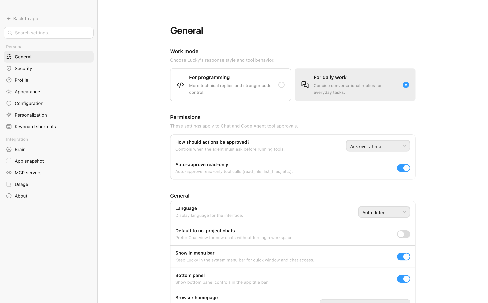
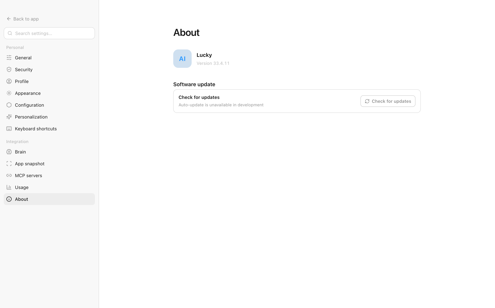

# Lucky project handbook

Lucky is a desktop AI coding assistant that runs on the user's machine. One Electron window holds chat, a code workbench, an embedded browser, a terminal, Git, and scheduled tasks. Models can be local (Ollama or LM Studio) or any OpenAI-compatible cloud API. Conversations, memories, and code-agent sessions are stored in a local SQLite database. There is no cloud account.

The repository and npm package are named `lucky-ai-client` (version `0.1.7`). The installer name, window title, and About page say **Lucky**. The auto-update app id is `space.luckly.ai.client`. Leave that id alone when renaming the product, or existing installs will not see updates.

## Contents

1. [Interface tour](#1-interface-tour)
2. [What it does](#2-what-it-does)
3. [Stack](#3-stack)
4. [Repository map](#4-repository-map)
5. [Processes and startup](#5-processes-and-startup)
6. [UI and state](#6-ui-and-state)
7. [Agent system](#7-agent-system)
8. [Tools, approval, and sandbox](#8-tools-approval-and-sandbox)
9. [Data and IPC](#9-data-and-ipc)
10. [Model providers](#10-model-providers)
11. [Browser, terminal, LSP, extensions, schedules](#11-browser-terminal-lsp-extensions-schedules)
12. [Development, tests, and release](#12-development-tests-and-release)
13. [Environment variables](#13-environment-variables)
14. [Limits and further reading](#14-limits-and-further-reading)

## 1. Interface tour

These screenshots are from an unpackaged development build. The About page therefore shows the Electron version (33.4.11 on this machine). A packaged build shows the version from `package.json`. The UI language follows the system locale; this set is English. Settings → General → Language can switch it to Simplified Chinese.

### Sign-in

Local mode asks for a display name and an optional email. The session lives in the renderer `localStorage` key `lucky-ai:auth`. It is not OAuth and there is no server account.

### Home

After sign-in the app opens on Home. The sidebar lists new chat, search, browser, scheduled tasks, and projects. The composer accepts `@` mentions for workspace context and lets the user pick a model and a project.

Professional mode (Settings → “For programming”) adds a Chat / Code switch at the top of the sidebar. Daily mode keeps chat, browser, and scheduled tasks.

### Settings

Open Settings from the user menu at the bottom of the sidebar, or with `⌘,`. General covers work mode, approvals, language, the menu bar, terminal placement, and the browser homepage.



About confirms the product name Lucky and offers a manual update check. Auto-update is disabled in a development build.



Other panels: Security (command sandbox), Profile, Appearance and theme palette, model configuration, Personalization (tone, custom instructions, memory), keyboard shortcuts, Brain (runtime observation), app snapshot, MCP servers, and usage.

### Scheduled tasks

The page has a task list and templates. When a task is due, the main process notifies the renderer. `notify` waits for the user to run it. `auto` runs it immediately.

### Embedded browser

The browser is an Electron `<webview>` on the `persist:lucky-ai-browser` partition. Requests for a new window stay inside the app as a new tab. The agent can read, click, fill, and capture the active page.

### Code workbench

Code view has a file tree, a multi-tab Monaco editor, breadcrumbs, Git changes, a problems panel, extensions, and a Code Agent on the right.

The Git panel shows changes, staging, commit, stash, pull/push, and conflicts. The agent also has read-only `GitStatus`, `GitDiffSummary`, and `GitFileHunks` tools.

## 2. What it does

| Area | Status | Notes |
| --- | --- | --- |
| Chat and agent loop | Usable | AgentScope ReAct loop, streaming, thinking blocks, tool cards, human confirmation, title summary, memory injection |
| Code workbench | Partial | File tree, Monaco, Shiki, Git, LSP diagnostics, diff view, terminal, Code Agent. Split editors and a full VS Code extension host are not done |
| Git | Partial | Branch, status, hunks, stage/discard, commit, AI commit message, AI diff review. Per-hunk staging has channels; the history graph is still coarse |
| LSP | Partial | The main process spawns language servers. Specs exist for TypeScript/JavaScript, Vue, Python (pyright), Go (gopls), and Rust (rust-analyzer). The commands must exist on the machine |
| Browser / research | Partial | In-app browser plus `WebSearch`, `WebFetch`, and `WebCrawl`. Page monitors fetch on an interval and compare a content hash |
| MCP / skills | Partial | MCP servers are JSON config, registered into the toolkit at startup. Built-in skills and `CreateSkill` can store a reusable procedure |
| Terminal | Partial | `node-pty` plus xterm, docked at the bottom or the right. Code view has its own bottom bar |
| Extension host | Partial | A VS Code API shim runs in a `utilityProcess` and can register commands, grammars, and themes. It is not a full marketplace host |
| Scheduled tasks | Partial | CRUD, templates, run-now, run history, notify/auto. The scheduler lives in the main process |
| Auto-update | Partial | `electron-updater`. On macOS, Squirrel accepts an update only after signing and notarization. See `build/SIGNING.md` |
| Sign-in | Partial | Local display name only. No OAuth |
| i18n | Usable | `zh-CN` and `en-US`. Keys must match; a structural parity test enforces that |
| Password autofill | Not built | Design document only. Do not treat it as a shipped feature |

## 3. Stack

- Electron 33 and electron-vite. Main, preload, and renderer build separately into `out/`.
- Vue 3, TypeScript, Pinia, vue-i18n, Tailwind CSS.
- Monaco Editor, `monaco-languageclient`, Shiki.
- `better-sqlite3` for the local database, in WAL mode.
- `node-pty` and xterm for the terminal.
- `@agentscope-ai/agentscope` for the agent loop and tool protocol.
- Crawlee and Playwright for web research. The default research engine is an Electron window; an environment variable can switch it to Playwright.
- `electron-updater` for updates. Prettier for formatting.
- Node `>=20.19.0` and pnpm `>=9`.

## 4. Repository map

```text
src/main        Electron main process: window, IPC, SQLite, agent, LSP, terminal, browser, updater
src/preload     contextBridge exposing window.luckyAI
src/renderer    Vue app: views, components, Pinia stores, locales
src/shared      Channel constants, shared types, env accessors, model presets
docs            Handbooks and architecture notes
e2e             Playwright-driven Electron smoke tests
build           Icons, entitlements, signing notes
out             electron-vite output (not source)
```

Main-process layout:

| Path | Responsibility |
| --- | --- |
| `src/main/ipc/` | One `register*Ipc()` per domain. Handlers return `IpcResult` |
| `src/main/services/` | Settings, conversations, workspace, Git, memory, security, sandbox, browser, schedules, LSP, updater |
| `src/main/agentscope/` | Agent lifetime, models, tools, event bridge, context storage |
| `src/main/db/` | `lucky-ai.db` and append-only migrations |
| `src/main/extension-host/` | Extension-host entry and the VS Code API shim |

The renderer has no vue-router. `App.vue` switches `ui.currentView` among `home`, `chat`, `code`, `browser`, and `scheduled`. Settings is an overlay, not a route. The code workbench is an async component. Monaco is prefetched on idle after startup.

## 5. Processes and startup

Window options live in `src/main/window.ts`: default 1400×875, `contextIsolation: true`, `nodeIntegration: false`, `sandbox: false`, `webviewTag: true`. Sandbox is off so native modules and the webview can load. Every `ipcMain.handle` therefore passes a sender guard that rejects webviews, child frames, and foreign origins.

Startup order in `src/main/index.ts`:

1. If `LUCKY_USER_DATA_DIR` is set, change `userData` immediately, before anything reads the database. End-to-end tests use this to stay off the developer's real data.
2. `LUCKY_E2E_HOOKS=1` publishes the browser-control service on `globalThis.__luckyE2E` for tests only.
3. Diagnostics and crash handlers install as early as possible.
4. After `app.ready`: macOS dock icon, theme, general runtime (tray and shortcuts), database, all IPC handlers, application menu, window.
5. Before quit: stop the updater, agent runtime, scheduler, and page monitor, then close the database.

The extension host is a second main-process entry, `src/main/extension-host/host-entry.ts`, built to `out/main/extension-host.js` and started with `utilityProcess.fork`.

`src/renderer/main.ts` creates Vue, Pinia, and i18n, and forwards `window.error` / `unhandledrejection` to the main-process diagnostics service.

## 6. UI and state

| Store | Owns |
| --- | --- |
| `auth` | Local display name. Signed-out users see only the login view |
| `ui` | Current view, sidebar width, command palette, dialogs, code sidebar tab |
| `session` / `project` | Session list, projects, active workspace |
| `chat` / `code-agent` | Home conversation and the code-side agent |
| `settings` / `theme` | Settings and theme, synced with the main process over IPC |
| `editor` / `workspace` | Open files, dirty state, workspace tree |
| `terminal` | pty sessions and dock position |
| `browser` | Tabs, bookmarks, history, downloads, page monitors |
| `scheduled-task` | Task list, plus the main-process “due” events |
| `updater` | Check, download, and install phases |
| `agent-runtime` | Brain observation snapshot |

Home and the code sidebar are two agent entry points. They share the main-process agent manager but not the same tables. Home messages live in `sessions` / `messages`. The code sidebar lives in `code_agent_sessions` / `code_agent_turns`.

Objects taken from a store must be turned into plain data before IPC. A Vue reactive Proxy cannot be structured-cloned; the main process then throws “An object could not be cloned”. The helper is `utils/ipc-serialize.ts` in the renderer.

## 7. Agent system

One user message crosses five layers:

```text
chat.store / code-agent.store
  └─ agentscope-client.ts          renderer: subscribe, then send
       ├─ pre-generate requestId
       ├─ subscribe to AGENT_EVENT:<id>
       └─ invoke AGENT_SEND  ───►  agent.ipc.ts
                                    └─ agent-manager.ts
                                         ├─ model-factory.ts
                                         ├─ toolkit-factory.ts
                                         └─ agent-storage.ts
       └─ accumulate text / thinking / tool  ◄── event-bridge.ts
```

Subscribe first, then invoke. The renderer generates `requestId` and uses it as the event-channel key. If the main process fails before that subscription exists (no workspace, no provider), the UI never sees the run settle.

`agent-manager.ts` caches an agent per conversation. It rebuilds the agent when the workspace, approval mode, or agent mode (`chat` | `code`) changes. The system prompt tells the model to inspect local context first, retry a failed tool once when that is safe, and review the diff plus the most relevant project check after an edit. When the context token budget is exceeded, older turns are compressed and the latest turns are kept.

Each turn may also select a dynamic workflow (direct answer, research, code review, debug, feature, refactor, verification, Git) and, when the change is broad, a plan → execute → verify cycle. `RunSubagents` delegates read-oriented collaborators. `RunParallelTasks` can propose writes; the main agent still reviews them.

At the end of a turn, `SqliteAgentStorage` writes the full context, including tool calls and the compression summary, to `agent_contexts`. That is why a restart does not wipe the conversation. The payload is trimmed to a size budget before insert. Corrupt JSON is dropped field by field with a warning. It does not take down the session.

`Write`, `Edit`, and `GeneratePdf` capture a file snapshot before they touch disk. Snapshots live in `agent_file_checkpoints` and support reverting a turn. A snapshot failure does not block the tool. Repeated write calls in the same turn are idempotent, and a write is checked against the content read earlier in that turn.

Two DeepSeek compatibility fixes are centralized. Do not reimplement them elsewhere:

- Boolean `exclusiveMinimum` in JSON Schema is rewritten by `sanitizeJsonSchema`. Draft-07 validation otherwise returns 400.
- Follow-up requests that contain `tool_calls` must send `reasoning_content` back unchanged. That happens at the HTTP layer.

The event sequence is documented in [Agent event flow](../architecture-agent-event-flow.md).

## 8. Tools, approval, and sandbox

Tools are assembled in `src/main/agentscope/toolkit-factory.ts`. The approval mode comes from conversation state:

| Mode | Behavior |
| --- | --- |
| `ask` | Writes, browser mutations, key presses, and task creation ask for confirmation |
| `auto` | Write confirmation is relaxed. Bash can still require confirmation when a dangerous-command rule matches |
| `full` | Per-call confirmation is off by default. A command policy with a confirm rule still gates Bash |

Read-only tools run immediately when “auto-approve read-only” is on. Tool, path, and command rules in Settings override the default with `allow`, `confirm`, or `block`.

Built-in tools:

| Group | Tools |
| --- | --- |
| Files | `Read` `Write` `Edit` `Glob` `Grep` |
| Web | `WebSearch` `WebFetch` `WebCrawl` |
| In-app browser | `OpenInAppBrowser` `ReadBrowserPage` `ControlBrowser` `SnapshotBrowserPage` `ScrollBrowserToText` `ListBrowserTabs` `ScrollBrowserPage` `PressBrowserKey` `HoverBrowserElement` `WaitForBrowserText` `CaptureBrowserPage` `ClickBrowserElement` `FillBrowserInput` |
| Git (read-only) | `GitStatus` `GitDiffSummary` `GitFileHunks` |
| Tasks and skills | `ListScheduledTasks` `CreateScheduledTask` `CreateSkill` `RunSubagents` `RunParallelTasks` |
| Other | `Calc` `Time` `GeneratePdf` `Bash` |

File paths are confined to the current workspace. `Bash` goes through the command sandbox:

| Mode | Behavior |
| --- | --- |
| `strict` | No network, and sensitive paths outside the workspace are blocked. Needs an OS backend; otherwise it degrades with a warning |
| `balanced` | Default. Network is allowed. Writes stay in the workspace when a backend can enforce that |
| `off` | Commands run in the host environment |

The backend is macOS Seatbelt, Linux bubblewrap, a restricted spawn, or Docker. Settings can prefer a container. The default image is `node:20-alpine`. The sandbox environment drops `*_TOKEN`, `*_SECRET`, and cloud credentials. Tool output and injected context are redacted by default.

Clicks, form fills, and key presses are external actions and require confirmation in `ask` mode. A site marked as auto-approved can skip per-call confirmation for browser actions.

MCP servers register after the built-in tools. One server failing to connect records a warning. It does not prevent the agent from starting.

## 9. Data and IPC

The database file is `userData/lucky-ai.db`. In development, `userData` is Electron's per-user directory. Tests point `LUCKY_USER_DATA_DIR` at a temp directory. The connection uses WAL, foreign keys, and a 5-second busy timeout.

The schema version is **18**. Migrations are append-only. Do not edit SQL that already shipped.

| Version | Contents |
| --- | --- |
| 1 | `projects`, `sessions`, `messages`, `app_preferences` |
| 2–3 | Message parts, session archive, browser bookmarks / history / downloads |
| 4–5 | Agent memory, full-text search, message meta |
| 6–8 | Code-agent sessions, then per-workspace isolation |
| 7, 9–11 | Scheduled tasks and run history |
| 12–14 | Runtime observation, `agent_contexts`, file checkpoints, token usage |
| 15–16 | Page monitors and the AI-analysis flag |
| 17 | Memory `use_count` |
| 18 | `agent_context_manifests`: per-turn context sources and budget |

Memory status is `active`, `archived`, or `deleted`. Rows are not physically deleted. `content_hash` and a canonical slot deduplicate them. The memory event table is append-only audit. Do not write one row per retrieved memory on the hot path.

Details are in [Storage schema](../architecture-storage.md).

IPC channel names have a single source: `src/shared/constants/ipc-channels.ts`. The preload groups them into `window.luckyAI`. Main-process handlers return `{ success, data | error }`. `success: true` means success. Do not treat `data === undefined` as failure.

`ipc-contract.test.ts` diffs three sets: constants, preload calls, and main-process registrations. A new channel missing from any set fails the test. The sender guard is described in [IPC contract](../architecture-ipc.md).

Pasted images are limited to 20MB and to png, jpeg, webp, or gif. With a workspace open they go to `<workspace>/.lucky/attachments`; otherwise they go to userData. An agent turn accepts at most 6 images, 10MB each, and the path must stay inside the workspace.

## 10. Model providers

Presets live in `src/shared/model-provider-presets.ts`. Protocol types are `ollama`, `openai`, `lmstudio`, and `anthropic`. Gemini, DeepSeek, Zhipu, DashScope, Doubao, xAI, Kimi, SiliconFlow, and OpenRouter all use OpenAI-compatible endpoints.

Ollama is enabled by default (`http://127.0.0.1:11434`, model `llama3.2`). The OpenAI-compatible and LM Studio presets start disabled. Each project can pin its own provider. Settings can test a connection, list models, and probe vision support.

Image attachments are sent only when the model capability allows it. API keys stay in main-process settings. The renderer does not log them, and `secret-redactor` covers log paths.

## 11. Browser, terminal, LSP, extensions, schedules

**Browser.** Bookmarks, history, and downloads are in SQLite. Site permissions (camera, microphone, location, notifications, clipboard) are asked once and remembered. Everything else is denied. `target=_blank` becomes an in-app tab. The context menu is drawn by the main process. The agent drives a page through the `webContentsId` reported by the renderer. Guest page script is not a general IPC surface.

**Terminal.** The main process owns one pty per session. The renderer uses xterm with the fit and web-links addons. The terminal theme follows the app theme.

**LSP.** The renderer syncs documents and talks to Monaco. The main process owns the server process. LSP methods are allow-listed (completion, hover, definition, references, rename, code action, and related requests). Language-server binaries are not bundled. If the command is missing, the status badge reports that.

**Extensions.** The app can list installed extensions, install from a folder or a VSIX, search a marketplace, enable or disable an extension, and run a registered command. The host API is a subset.

**Scheduled tasks.** The scheduler is in the main process. Cadences are once, daily, weekly, workdays, monthly, and custom. Run mode is `notify` or `auto`. Failures retry. The agent can create a task with a tool instead of writing a crontab entry.

**Updates.** Phases are idle, checking, available, downloaded, and error. Installers are published to [dennis9486/lucky-ai](https://github.com/dennis9486/lucky-ai/releases), and that same repository is embedded as the update feed. Windows NSIS and Linux AppImage can update automatically. macOS auto-update also requires a Developer ID signature, notarization, plus the zip and `latest-mac.yml` on the release. This repository is public, so clients do not need a token to download updates.

## 12. Development, tests, and release

```bash
pnpm install          # install and rebuild better-sqlite3, node-pty
pnpm dev              # electron-vite hot reload; clears ELECTRON_RUN_AS_NODE
pnpm type-check       # vue-tsc + tsc
pnpm lint             # ESLint
pnpm test             # Vitest, src only
pnpm build            # type-check + production build
pnpm test:e2e         # build, then Playwright launches Electron
pnpm package          # electron-builder --dir, no installer
pnpm dist             # dmg/zip, nsis, AppImage
pnpm release          # build and publish GitHub Releases
```

CI (`.github/workflows/ci.yml`) has two stages:

1. On Ubuntu: type-check, lint, unit tests.
2. On Ubuntu, macOS, and Windows: build, Playwright, then `electron-builder --dir`. Linux uses xvfb.

End-to-end tests cover boot, the preload bridge, a settings round-trip, session persistence, the Git workspace, browser control, and an agent-conversation skeleton. Electron is single-instance, so Playwright runs with `workers: 1`. Tests must set `LUCKY_USER_DATA_DIR` so they do not write the developer's database.

Bump `version` in `package.json` before a release. macOS signing steps are in `build/SIGNING.md`. `notarize` defaults to `false`, so a build without Apple credentials still succeeds.

## 13. Environment variables

`src/shared/env.ts` is the typed accessor. Names use the `LUCKY_` prefix. `.env.example` lists the optional ones.

| Variable | What actually happens |
| --- | --- |
| `LUCKY_USER_DATA_DIR` | Redirects Electron `userData` before the database opens. Used by end-to-end tests. This is the data-directory switch that works today |
| `LUCKY_E2E_HOOKS` | `1` exposes the browser-control service |
| `LUCKY_LOG_LEVEL` | Accessor default is `info`. It applies only when the process environment already has the value |
| `LUCKY_DEV_TOOLS` | Accessor default is `true`. DevTools in development are mainly controlled by `app.isPackaged` |
| `LUCKY_WEB_RESEARCH_ENGINE` | `electron` (default) or `playwright` |
| `LUCKY_OLLAMA_BASE_URL` / `LUCKY_OPENAI_BASE_URL` | Fallback preset URLs |
| `LUCKY_AGENT_BUILTIN_SKILLS` | Inject the built-in English skills. Default on |
| `LUCKY_AGENT_EXTRA_SKILL_PATHS` / `LUCKY_AGENT_EXTRA_SKILL_DIRS` | Extra skill files or directories. `:` on macOS/Linux, `;` on Windows |
| `LUCKY_DATA_DIR` / `LUCKY_DB_PATH` | Declared in `env.ts` and the example file only. `DatabaseService` always uses `userData/lucky-ai.db`. These two variables do not move the database today |

`src/main/bootstrap-env.ts` loads `.env`, then `.env.{NODE_ENV}`, then `.env.local`, without overriding variables that already exist. `src/main/index.ts` does not import that loader, so a secret placed in `.env.local` does not enter the main process by itself. Put required values in the process environment, or wire the loader into the entry later.

Production packages do not contain `.env` files.

## 14. Limits and further reading

- Sign-in is not an account system. Signing out clears the local display name.
- Password storage and autofill exist only as a design. See [password-autofill-design.md](../password-autofill-design.md). Do not write a plaintext password into SQLite or renderer state.
- The extension host, LSP, and split editors are partial. Language servers and formatters depend on commands installed on the machine.
- An unpackaged About page shows Electron's version, not `0.1.0`.
- Before changing IPC, a table, or the agent event order, read the matching note and the existing tests. Append a migration. Do not edit a migration that already shipped.

Further reading:

- [Agent event flow](../architecture-agent-event-flow.md)
- [IPC contract](../architecture-ipc.md)
- [Storage schema](../architecture-storage.md)
- [macOS signing and notarization](../../build/SIGNING.md)
