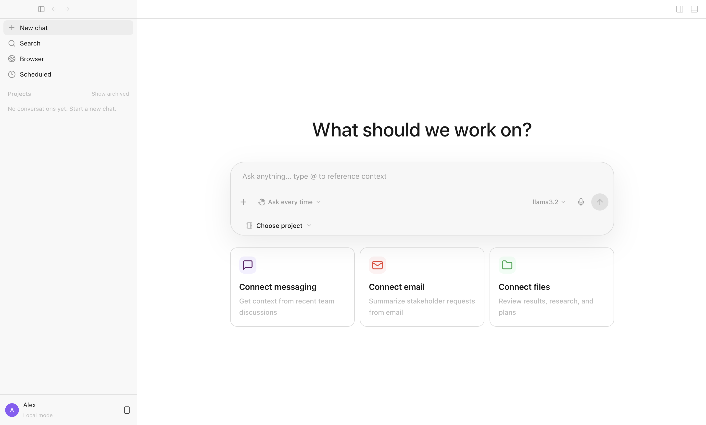
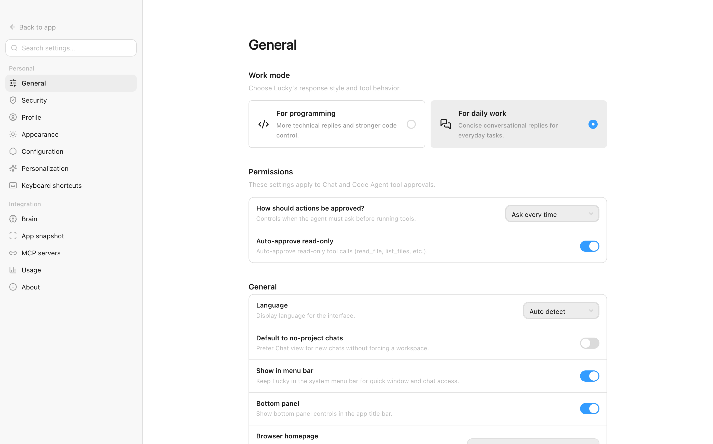
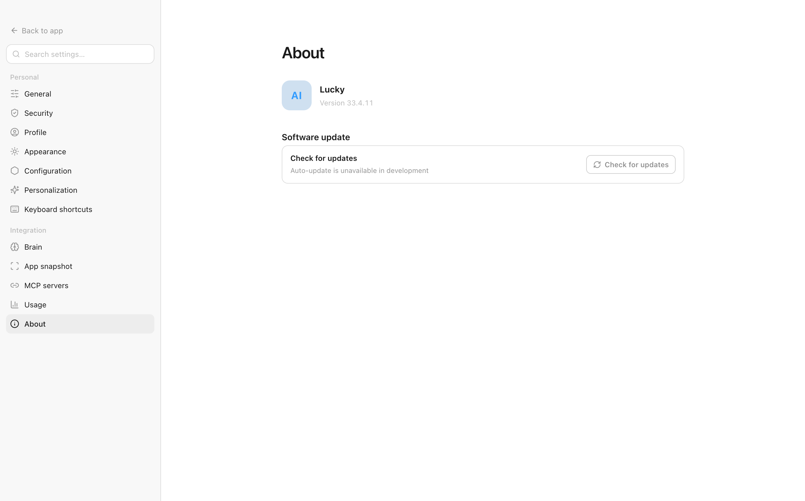

# Lucky 项目手册

Lucky 是一款跑在本机上的桌面 AI 编程助手。它把对话、代码工作台、内嵌浏览器、终端、Git 和定时任务放在同一个 Electron 窗口里。模型可以是本机的 Ollama / LM Studio，也可以是 OpenAI 兼容的云端接口。对话、记忆和代码会话都写在本机 SQLite 里，不依赖云账号。

仓库与 npm 包名是 `lucky-ai-client`（当前版本 `0.1.8`）。安装包显示名、窗口标题和关于页都是 **Lucky**。自动更新用的应用 ID 是 `space.luckly.ai.client`，不要随显示名一起改，否则已安装的用户会对不上更新。

## 目录

1. [界面导览](#1-界面导览)
2. [能做什么](#2-能做什么)
3. [技术栈](#3-技术栈)
4. [仓库地图](#4-仓库地图)
5. [进程与启动](#5-进程与启动)
6. [界面与状态](#6-界面与状态)
7. [Agent 系统](#7-agent-系统)
8. [工具、审批与沙箱](#8-工具审批与沙箱)
9. [数据与 IPC](#9-数据与-ipc)
10. [模型供应商](#10-模型供应商)
11. [浏览器、终端、LSP、扩展、定时任务](#11-浏览器终端lsp扩展定时任务)
12. [开发、测试与发布](#12-开发测试与发布)
13. [环境变量](#13-环境变量)
14. [边界与延伸阅读](#14-边界与延伸阅读)

## 1. 界面导览

下面的截图来自未打包的开发构建。关于页上的版本号因此显示为 Electron 版本（本机是 33.4.11），正式安装包会显示 `package.json` 里的应用版本。界面语言跟随系统，这组图是英文；设置 → 常规 → 语言可以切到简体中文。

### 登录

本地模式只要求一个显示名称，可选填邮箱。会话写在渲染进程的 `localStorage`（键 `lucky-ai:auth`），不是 OAuth，也没有服务端账号。

### 首页

登录后默认进入首页。左侧是新对话、搜索、浏览器、已安排任务和项目列表；中间是输入框，可以用 `@` 引用工作区上下文，并选择模型和项目。



专业模式（设置里的「适用于编程」）打开后，侧栏顶部会出现 Chat / Code 切换。日常模式只有聊天、浏览器和已安排任务。

### 设置

设置从侧栏底部的用户菜单进入，也可以用 `⌘,`。常规页管工作模式、审批、语言、菜单栏、终端停靠和浏览器主页。



关于页确认产品名是 Lucky，并提供手动检查更新。开发构建里自动更新是关闭的。



设置还包含：安全（命令沙箱）、个人资料、外观与主题色板、模型配置、个性化（语气、自定义指令、记忆）、快捷键、Brain（运行时观测）、应用快照、MCP 服务器、用量。

### 已安排任务

定时任务有任务列表和模板。到点后主进程通知渲染进程：`notify` 模式等用户点运行，`auto` 模式直接跑。

### 内嵌浏览器

浏览器是 Electron `<webview>`，分区是 `persist:lucky-ai-browser`。新窗口请求不会弹出系统窗口，而是在应用内开新标签。Agent 可以读取、点击、填表和截图当前页。

### 代码工作台

Code 视图包含文件树、多标签 Monaco 编辑器、面包屑、Git 变更、问题面板、扩展，以及右侧 Code Agent。

Git 面板可以看变更、暂存、提交、stash、拉取/推送和冲突。Agent 另有只读的 `GitStatus` / `GitDiffSummary` / `GitFileHunks` 工具。

## 2. 能做什么

| 区域 | 状态 | 说明 |
| --- | --- | --- |
| 对话与 Agent 循环 | 可用 | AgentScope ReAct 循环、流式输出、思考块、工具卡片、人工确认、标题摘要、记忆注入 |
| 代码工作台 | 部分 | 文件树、Monaco、Shiki、Git、LSP 诊断、差异视图、终端、Code Agent。分屏编辑和完整 VS Code 扩展宿主仍不完整 |
| Git | 部分 | 分支、状态、hunk、暂存/丢弃、提交、AI 提交说明、AI diff 审阅。按 hunk 暂存已有通道；历史图还比较粗 |
| LSP | 部分 | 主进程拉起语言服务器。内置规格：TypeScript/JavaScript、Vue、Python（pyright）、Go（gopls）、Rust（rust-analyzer）。机器上要有对应命令 |
| 浏览器 / 检索 | 部分 | 应用内浏览器，加上 `WebSearch` / `WebFetch` / `WebCrawl`。页面监控会按间隔抓取并比对哈希 |
| MCP / Skills | 部分 | JSON 配置 MCP，启动时注册进 Toolkit。内置 Skill 与 `CreateSkill` 可沉淀流程 |
| 终端 | 部分 | `node-pty` + xterm，可停在底部或右侧。Code 视图有自己的底栏 |
| 扩展宿主 | 部分 | `utilityProcess` 里跑一份 VS Code API 垫片，能注册命令、语法和主题。不是完整扩展市场 |
| 定时任务 | 部分 | CRUD、模板、立即运行、运行历史、notify/auto。调度器在主进程里跑 |
| 自动更新 | 部分 | `electron-updater`。macOS 要签名并公证后 Squirrel 才接受更新，见 `build/SIGNING.md` |
| 登录 | 部分 | 仅本地显示名。OAuth 还没有 |
| 国际化 | 可用 | `zh-CN` 与 `en-US`，键必须成对，有结构对账测试 |
| 密码自动填充 | 未做 | 只有设计文档，不要当成已上线功能 |

## 3. 技术栈

- Electron 33 + electron-vite。主进程、preload、渲染进程分三次构建，产物在 `out/`。
- Vue 3、TypeScript、Pinia、vue-i18n、Tailwind CSS。
- Monaco Editor、`monaco-languageclient`、Shiki。
- `better-sqlite3` 做本地库，WAL 模式。
- `node-pty` 与 xterm 做终端。
- `@agentscope-ai/agentscope` 做 Agent 循环和工具协议。
- Crawlee、Playwright 做网页检索；默认检索引擎是 Electron 窗口，可用环境变量改成 Playwright。
- `electron-updater` 做更新。Prettier 做格式化。
- 要求 Node `>=20.19.0`，包管理器 pnpm `>=9`。

## 4. 仓库地图

```text
src/main        Electron 主进程：窗口、IPC、SQLite、Agent、LSP、终端、浏览器、更新
src/preload     contextBridge，向渲染进程暴露 window.luckyAI
src/renderer    Vue 应用：页面、组件、Pinia store、locale
src/shared      通道常量、共享类型、环境变量访问、模型预设
docs            手册与架构短文
e2e             Playwright 驱动的 Electron 冒烟测试
build           图标、entitlements、签名说明
out             electron-vite 构建产物（不作为源码维护）
```

主进程按职责拆开：

| 目录 | 职责 |
| --- | --- |
| `src/main/ipc/` | 每个域一个 `register*Ipc()`，统一返回 `IpcResult` |
| `src/main/services/` | 设置、会话、工作区、Git、记忆、安全、沙箱、浏览器、定时任务、LSP、更新 |
| `src/main/agentscope/` | Agent 生命周期、模型、工具、事件桥、上下文存储 |
| `src/main/db/` | `lucky-ai.db` 与只追加的迁移 |
| `src/main/extension-host/` | 扩展宿主入口和 VS Code API 垫片 |

渲染进程没有 vue-router。`App.vue` 用 `ui.currentView` 切换 `home`、`chat`、`code`、`browser`、`scheduled`。设置是盖在上面的一层，不是独立路由。Code 工作台用异步组件，启动后再空闲预热 Monaco。

## 5. 进程与启动

窗口配置在 `src/main/window.ts`：默认 1400×875，`contextIsolation: true`，`nodeIntegration: false`，`sandbox: false`，`webviewTag: true`。`sandbox: false` 是因为要加载原生模块和 webview；因此所有 `ipcMain.handle` 都先过来源守卫，拒绝 webview、子 frame 和外部 origin。

`src/main/index.ts` 的启动顺序：

1. 若设置了 `LUCKY_USER_DATA_DIR`，立刻改 `userData`。必须发生在任何读数据库的代码之前。E2E 靠这个隔离真实用户数据。
2. `LUCKY_E2E_HOOKS=1` 时把浏览器控制服务挂到 `globalThis.__luckyE2E`，只给测试用。
3. 诊断日志和崩溃处理尽早装上。
4. `app.ready` 后：macOS 码头图标、主题、通用运行时（托盘、快捷键）、打开数据库、注册全部 IPC、应用菜单、创建窗口。
5. 退出前停掉更新器、Agent runtime、定时调度、页面监控，并关闭数据库。

扩展宿主是单独入口 `src/main/extension-host/host-entry.ts`，构建成 `out/main/extension-host.js`，由 `utilityProcess.fork` 拉起。

渲染进程入口 `src/renderer/main.ts` 创建 Vue、Pinia 和 i18n，并把 `window.error` / `unhandledrejection` 报给主进程诊断服务。

## 6. 界面与状态

Pinia store 与界面的对应关系：

| Store | 管什么 |
| --- | --- |
| `auth` | 本地显示名。未登录只显示登录页 |
| `ui` | 当前视图、侧栏宽度、命令面板、对话框、Code 侧栏页签 |
| `session` / `project` | 会话列表、项目、当前工作区 |
| `chat` / `code-agent` | 首页对话与代码侧栏 Agent |
| `settings` / `theme` | 设置与主题，经 IPC 与主进程同步 |
| `editor` / `workspace` | 打开的文件、脏状态、工作区树 |
| `terminal` | pty 会话与停靠位置 |
| `browser` | 标签、书签、历史、下载、页面监控 |
| `scheduled-task` | 任务列表，并监听主进程的到点事件 |
| `updater` | 检查、下载、安装阶段 |
| `agent-runtime` | Brain 观测快照 |

首页和代码侧栏是两条 Agent 入口，共用主进程的 Agent 管理器，但持久化表不同：首页消息在 `sessions` / `messages`，代码侧栏在 `code_agent_sessions` / `code_agent_turns`。

从 store 取出的对象过 IPC 之前要先变成普通对象。Vue 的响应式 Proxy 无法被 structured clone，主进程会收到 “An object could not be cloned”。序列化工具在渲染进程的 `utils/ipc-serialize.ts`。

## 7. Agent 系统

一次用户消息跨五层：

```text
chat.store / code-agent.store
  └─ agentscope-client.ts          渲染进程：先订阅，再发送
       ├─ 预生成 requestId
       ├─ 订阅 AGENT_EVENT:<id>
       └─ invoke AGENT_SEND  ───►  agent.ipc.ts
                                    └─ agent-manager.ts
                                         ├─ model-factory.ts
                                         ├─ toolkit-factory.ts
                                         └─ agent-storage.ts
       └─ 累积 text / thinking / tool  ◄── event-bridge.ts
```

必须先订阅再调用。`requestId` 由渲染侧生成，并当作事件通道的键。如果主进程在订阅前就失败（没有工作区、没有 Provider），界面会一直等不到结束。

`agent-manager.ts` 按会话缓存 Agent。工作区、审批模式或 Agent 模式（`chat` | `code`）变了就重建。系统提示词要求先看本地上下文，工具失败后安全地重试一次，改完要看 diff 并跑项目里最相关的检查。上下文 token 超过预算时会压缩，并保留最近若干轮。

每轮还会选一个动态工作流（直接回答、检索、代码审阅、修 bug、实现功能、重构、验证、Git），必要时再套一层 plan → execute → verify。子代理走 `RunSubagents`，可写的并行任务走 `RunParallelTasks`，结果回到主 Agent。

轮次结束时 `SqliteAgentStorage` 把完整上下文（含工具调用和压缩摘要）写入 `agent_contexts`。这是重启后还记得对话的原因。写入前会把上下文裁到体积预算内。损坏的 JSON 按字段丢掉并打警告，不让整个会话崩掉。

`Write` / `Edit` / `GeneratePdf` 落盘前会抓文件前像，存在 `agent_file_checkpoints`，支持按轮次回滚。快照失败不阻断工具。同一轮里重复的写工具调用有幂等保护；写文件前还会对照本轮读过的内容做乐观检查。

DeepSeek 兼容有两处专门处理，不要在别的层再做一遍：

- JSON Schema 里布尔型 `exclusiveMinimum` 会被 `sanitizeJsonSchema` 洗掉，否则按 draft-07 校验会 400。
- 带 `tool_calls` 的后续请求必须原样带回 `reasoning_content`，这件事在 HTTP 层做。

更细的事件时序见 [Agent 事件流](../architecture-agent-event-flow.md)。

## 8. 工具、审批与沙箱

工具在 `src/main/agentscope/toolkit-factory.ts` 装配。审批模式来自会话状态：

| 模式 | 行为 |
| --- | --- |
| `ask` | 写文件、改浏览器、按键、建任务等需要确认 |
| `auto` | 放宽写操作确认；Bash 仍可能因危险命令规则要求确认 |
| `full` | 默认不再逐次确认。命令策略里若有 confirm 规则，Bash 仍要确认 |

只读工具在「自动批准只读」开启时直接执行。设置里的工具/路径/命令规则可以覆盖默认值：`allow`、`confirm` 或 `block`。

内置工具：

| 组 | 工具 |
| --- | --- |
| 文件 | `Read` `Write` `Edit` `Glob` `Grep` |
| 网页 | `WebSearch` `WebFetch` `WebCrawl` |
| 应用内浏览器 | `OpenInAppBrowser` `ReadBrowserPage` `ControlBrowser` `SnapshotBrowserPage` `ScrollBrowserToText` `ListBrowserTabs` `ScrollBrowserPage` `PressBrowserKey` `HoverBrowserElement` `WaitForBrowserText` `CaptureBrowserPage` `ClickBrowserElement` `FillBrowserInput` |
| Git（只读） | `GitStatus` `GitDiffSummary` `GitFileHunks` |
| 任务与技能 | `ListScheduledTasks` `CreateScheduledTask` `CreateSkill` `RunSubagents` `RunParallelTasks` |
| 其他 | `Calc` `Time` `GeneratePdf` `Bash` |

文件路径被限制在当前工作区。`Bash` 走命令沙箱。沙箱模式：

| 模式 | 行为 |
| --- | --- |
| `strict` | 断网，并阻断工作区外的敏感路径。需要系统后端，否则降级并告警 |
| `balanced` | 默认。允许网络，写文件尽量留在工作区 |
| `off` | 直接在宿主环境执行 |

后端按平台选择：macOS Seatbelt、Linux bubblewrap、受限 spawn，或 Docker（设置里可要求容器，镜像默认 `node:20-alpine`）。沙箱环境变量会丢掉 `*_TOKEN`、`*_SECRET`、云厂商密钥等。工具输出和注入上下文默认做密钥遮罩。

点击、填表、按键视为对外动作，在 `ask` 模式下要确认。若当前站点被设为自动授权，浏览器动作类工具可以跳过逐次确认。

MCP 服务器在内置工具之后注册。单个服务器连不上只记警告，不让整个 Agent 起不来。

## 9. 数据与 IPC

数据库文件是 `userData/lucky-ai.db`。开发时 `userData` 在系统的 Electron 用户目录里；测试用 `LUCKY_USER_DATA_DIR` 指到临时目录。库使用 WAL、外键和 5 秒 busy timeout。

Schema 当前版本是 **18**。迁移只追加，不改历史 SQL。表的演进：

| 版本 | 内容 |
| --- | --- |
| 1 | `projects` `sessions` `messages` `app_preferences` |
| 2–3 | 消息 parts、会话归档、浏览器书签/历史/下载 |
| 4–5 | Agent 记忆、全文检索、消息 meta |
| 6–8 | Code Agent 会话，以及按工作区隔离 |
| 7, 9–11 | 定时任务与运行历史 |
| 12–14 | runtime 观测、`agent_contexts`、文件前像、token 用量 |
| 15–16 | 页面监控及 AI 分析开关 |
| 17 | 记忆 `use_count` |
| 18 | `agent_context_manifests`，记录每轮上下文来源和预算 |

记忆状态是 `active` / `archived` / `deleted`，只翻转状态，不物理删除。`content_hash` 和 canonical slot 用来去重。记忆事件表是只写审计，不要在检索热路径上逐条写。

细节和约束见 [存储 Schema](../architecture-storage.md)。

IPC 通道的唯一名单在 `src/shared/constants/ipc-channels.ts`。preload 按域组成 `window.luckyAI`。主进程 handler 返回 `{ success, data | error }`。`success: true` 就是成功，不要用 `data === undefined` 判断失败。

`ipc-contract.test.ts` 会核对三份名单：常量、preload 调用、主进程注册。新增通道缺任何一处，测试就会红。来源守卫见 [IPC 契约](../architecture-ipc.md)。

粘贴图片最多 20MB，只接受 png / jpeg / webp / gif。有工作区时存到 `<workspace>/.lucky/attachments`，否则存到 userData。Agent 单轮最多 6 张图片，单张上限 10MB，并且路径必须在工作区内。

## 10. 模型供应商

预设在 `src/shared/model-provider-presets.ts`。协议类型只有 `ollama`、`openai`、`lmstudio`、`anthropic`。Gemini、DeepSeek、智谱、百炼、豆包、xAI、Kimi、SiliconFlow、OpenRouter 都走 OpenAI 兼容端点。

默认启用 Ollama（`http://127.0.0.1:11434`，模型 `llama3.2`）。OpenAI 兼容和 LM Studio 预设默认关闭。每个项目可以单独指定 Provider。设置里可以测试连接、列出模型、探测视觉能力。

视觉附件只在模型能力允许时送进请求。密钥留在主进程设置里，渲染进程拿不到明文去打日志；日志路径上还有 `secret-redactor`。

## 11. 浏览器、终端、LSP、扩展、定时任务

**浏览器。** 书签、历史、下载存在 SQLite。站点权限（摄像头、麦克风、定位、通知、剪贴板）第一次询问并记住，其余拒绝。`target=_blank` 变成应用内新标签。右键菜单由主进程画。Agent 通过渲染进程上报的 `webContentsId` 操作页面，不把 guest 的脚本能力暴露成通用 IPC。

**终端。** 主进程为每个会话持有一个 pty。渲染进程用 xterm 的 fit 与 web-links 插件，主题跟着应用主题走。

**LSP。** 渲染进程负责文档同步和 Monaco 集成，主进程负责进程生命周期。允许的 LSP 方法有白名单（补全、悬停、定义、引用、重命名、代码动作等）。语言服务器二进制不随应用打包，找不到命令时状态徽章会显示不可用。

**扩展。** 可以列出已安装扩展、从目录或 VSIX 安装、搜索市场、启用/停用、执行已注册命令。宿主 API 是子集。

**定时任务。** 调度器在主进程。支持 once、daily、weekly、workdays、monthly、custom。运行模式是 `notify` 或 `auto`。失败有重试。Agent 也可以用工具创建任务，而不是去写 crontab。

**更新。** 阶段是 idle / checking / available / downloaded / error。安装包发布在 [dennis9486/lucky-ai](https://github.com/dennis9486/lucky-ai/releases)，打包时写入的更新源也是这个仓库。Windows 的 NSIS 和 Linux 的 AppImage 可以自动更新。macOS 自动更新还要求 Developer ID 签名、公证，以及 Release 里的 zip 和 `latest-mac.yml`。本仓库目前是公开仓库，客户端拉更新不需要 token。

## 12. 开发、测试与发布

```bash
pnpm install          # 安装依赖，并 rebuild better-sqlite3、node-pty
pnpm dev              # electron-vite 热更新。会清掉 ELECTRON_RUN_AS_NODE
pnpm type-check       # vue-tsc + tsc
pnpm lint             # ESLint
pnpm test             # Vitest，只扫 src
pnpm build            # type-check + 生产构建
pnpm test:e2e         # 先 build，再用 Playwright 启动 Electron
pnpm package          # electron-builder --dir，不解出安装器
pnpm dist             # dmg/zip、nsis、AppImage
pnpm release          # build 并发布到 GitHub Releases
```

CI（`.github/workflows/ci.yml`）分两段：

1. Ubuntu 上做类型检查、lint、单元测试。
2. Ubuntu、macOS、Windows 上分别 build、跑 Playwright，再 `electron-builder --dir` 做解包冒烟。Linux 用 xvfb。

E2E 覆盖启动、preload、设置往返、会话持久化、Git 工作区、浏览器控制、Agent 对话骨架。Electron 单实例，Playwright 配置是 `workers: 1`。测试必须设置 `LUCKY_USER_DATA_DIR`，避免写到开发者自己的库。

发版前先改 `package.json` 的 `version`。macOS 签名步骤在 `build/SIGNING.md`。`notarize` 默认是 `false`，没有凭证时构建不会失败。

## 13. 环境变量

`src/shared/env.ts` 是类型化读取层，前缀是 `LUCKY_`。`.env.example` 列出了可选项。

| 变量 | 实际效果 |
| --- | --- |
| `LUCKY_USER_DATA_DIR` | 在数据库打开前改掉 Electron `userData`。E2E 使用。这是目前真正生效的数据目录开关 |
| `LUCKY_E2E_HOOKS` | 设为 `1` 时暴露浏览器控制服务 |
| `LUCKY_LOG_LEVEL` | 访问器默认 `info`。要生效，进程环境里得已经有这个值 |
| `LUCKY_DEV_TOOLS` | 访问器默认 `true`。开发窗口是否开 DevTools 主要由 `app.isPackaged` 决定 |
| `LUCKY_WEB_RESEARCH_ENGINE` | `electron`（默认）或 `playwright` |
| `LUCKY_OLLAMA_BASE_URL` / `LUCKY_OPENAI_BASE_URL` | 预设地址的回退值 |
| `LUCKY_AGENT_BUILTIN_SKILLS` | 是否注入内置英文 Skill，默认开 |
| `LUCKY_AGENT_EXTRA_SKILL_PATHS` / `LUCKY_AGENT_EXTRA_SKILL_DIRS` | 额外 Skill 文件或目录。macOS/Linux 用 `:`，Windows 用 `;` |
| `LUCKY_DATA_DIR` / `LUCKY_DB_PATH` | 只在 `env.ts` 和示例文件里声明。`DatabaseService` 仍固定使用 `userData/lucky-ai.db`，这两个变量目前不会搬走数据库 |

`src/main/bootstrap-env.ts` 会按 `.env` → `.env.{NODE_ENV}` → `.env.local` 加载，且不覆盖已有环境变量。当前 `src/main/index.ts` 没有 import 它，所以把密钥写进 `.env.local` 不会自动进主进程。需要的值请直接放在启动进程的环境里，或以后把这个加载器接到入口。

生产包不包含 `.env`。

## 14. 边界与延伸阅读

- 登录不是账号系统。退出只是清掉本地显示名。
- 密码保管和自动填充还停留在设计，见 [password-autofill-design.md](../password-autofill-design.md)。不要把明文密码写入 SQLite 或渲染进程状态。
- 扩展宿主、LSP 和代码分屏都是部分实现。语言服务器和格式化依赖本机已安装的命令。
- 未打包时关于页版本号是 Electron 的版本，不是 `0.1.0`。
- 改 IPC、表结构或 Agent 事件顺序时，先读对应的专题文档和已有测试，再追加，不要改历史迁移。

专题文档：

- [Agent 事件流](../architecture-agent-event-flow.md)
- [IPC 契约](../architecture-ipc.md)
- [存储 Schema](../architecture-storage.md)
- [macOS 签名与公证](../../build/SIGNING.md)
